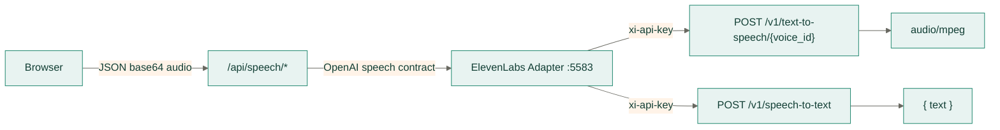

# Moss ElevenLabs Speech Adapter

> 状态：可选的本机云语音适配层
> 浏览器入口：`http://127.0.0.1:5583`
> 上游：ElevenLabs `https://api.elevenlabs.io`

该服务把 ElevenLabs 的文本转语音与语音转文本 API 翻译为 Moss 已支持的 OpenAI 兼容语音
契约。它独立运行在 `5583`，不修改 `5578` TTS 网关、`5580` ASR 服务或任何现有默认接入
方式；只有学习者在“偏好设置 → 语音服务接入”中主动选择 HTTP API 并填写本服务地址时才会
被使用。

实现依据：

- [ElevenAPI 快速入门](https://elevenlabs.io/docs/zh/eleven-api/quickstart)
- [Create speech](https://elevenlabs.io/docs/api-reference/text-to-speech/convert)
- [Create transcript](https://elevenlabs.io/docs/api-reference/speech-to-text/convert)

## 拓扑



`ELEVENLABS_API_KEY` 只存在于本机服务进程。浏览器配置里的“密钥”字段仅用于可选的
`MOSS_ELEVENLABS_ACCESS_TOKEN`，不会转发给 ElevenLabs。

## 安装与启动

```bash
pnpm elevenlabs:setup
cp backend/services/elevenlabs/.env.local.example backend/services/elevenlabs/.env.local
# 在 .env.local 中填入 ELEVENLABS_API_KEY
pnpm elevenlabs:start
curl http://127.0.0.1:5583/health
```

`elevenlabs:setup` 创建独立 `.venv`，不读取也不修改 TTS/ASR 的虚拟环境。
`elevenlabs:start` 只启动本适配器；`pnpm dev:offline` 不会自动启动它。

本机实例配置放在同目录 `.env.local`（gitignore），可提交模板为 `.env.local.example`，
其中包含当前服务实际使用的本地模型 `eleven_v4` / `scribe_v2`、默认音色与默认输出格式。
未显式设置的项由 `start.mjs` 从 `frontend/src/lib/speech-rules.json` 注入，优先级为
**规则表 < `.env.local` < shell 环境变量**；跨服务规则总结见 `docs/speech-rules.md`。

未设置 `ELEVENLABS_API_KEY` 时服务仍会启动，`/health` 返回 `503`，语音请求返回
`error.code = "not_configured"`，方便先验证端口和部署。

## 在 Moss 中启用

1. 启动本服务，并确认 `curl http://127.0.0.1:5583/health` 返回 `ready: true`。
2. 打开“偏好设置 → 语音服务接入”。
3. ASR 与 TTS 都选择“HTTP API”。
4. 两者接口地址填写 `http://127.0.0.1:5583/v1`。
5. ASR 模型填写 `scribe_v2`，TTS 模型填写 `eleven_v4`。
6. TTS 音色填写 ElevenLabs voice ID，或使用 `alloy`、`echo`、`fable`、`onyx`、`nova`、
   `shimmer` 六个兼容别名。

本服务只适合本机开发或桌面运行：`/api/speech/*` 在生产环境会拒绝回环地址，Vercel
部署也不能访问用户本机的 `5583`。生产环境应继续使用受白名单保护的远程 OpenAI 兼容
语音端点。

## HTTP 契约

### `GET /health`

```json
{
  "ready": true,
  "configured": true,
  "service": "moss-elevenlabs",
  "provider": "elevenlabs",
  "models": { "tts": "eleven_v4", "asr": "scribe_v2" },
  "defaultVoice": "JBFqnCBsd6RMkjVDRZzb",
  "accessTokenRequired": false
}
```

### `POST /v1/audio/speech`

OpenAI 兼容请求：

```json
{
  "model": "eleven_v4",
  "input": "Could I get a coffee, please?",
  "voice": "JBFqnCBsd6RMkjVDRZzb",
  "response_format": "mp3",
  "speed": 0.95
}
```

成功时原样返回音频字节，`Content-Type` 为 `audio/mpeg`、`audio/ogg`、`audio/pcm` 或
`audio/wav`，并设置 `Cache-Control: no-store`。`response_format` 支持 `mp3`、`opus`、
`pcm`、`wav`；`aac` 与 `flac` 返回 `400 unsupported_format`，不会把其他编码伪装成目标
格式。

`speed` 接受 `0.5`–`2`，转发前收敛到 ElevenLabs 的 `0.7`–`1.2`。`input` 最多
2000 字符。请求在服务端转换为：

```text
POST /v1/text-to-speech/{voice_id}?output_format=...
{ "text": ..., "model_id": ..., "voice_settings": { "speed": ... } }
```

### `POST /v1/audio/speech/test`

本机适配器自检探针。用通用规则配置的默认参数真实合成一次，**只返回结构化诊断，不回传
音频本体**，便于在不解码音频的情况下确认模型、音色、格式与上游连通性。请求体可为空，也可以
用 `text`（或 `input`）、`voice`、`model`、`response_format`、`speed` 覆盖默认值。

```json
{
  "ok": true,
  "service": "moss-elevenlabs",
  "provider": "elevenlabs",
  "model": "eleven_v4",
  "voice": "alloy",
  "format": "mp3",
  "contentType": "audio/mpeg",
  "bytes": 10240,
  "elapsedMs": 321,
  "checks": { "audioContentType": true, "minimumBytes": true }
}
```

鉴权、密钥与错误语义与 `/v1/audio/speech` 一致。这是 5583 专用端点：设置页的
「测试合成接口」走的是 `/api/speech/tts/test`，它仍调用标准 `/audio/speech`，因此对任何
OpenAI 兼容端点都可用。

### `POST /v1/audio/transcriptions`

`multipart/form-data`：

| 字段 | 必填 | 说明 |
| --- | --- | --- |
| `file` | 是 | 音频或视频片段，最多 8 MB |
| `model` | 否 | 默认 `scribe_v2` |
| `language` | 否 | ISO 639-1/3 代码，例如 `zh`、`en` |

成功响应：

```json
{ "text": "Could I get a latte?" }
```

服务转发到 `POST /v1/speech-to-text`，使用 `model_id` 与可选的 `language_code`。

## 配置

| 变量 | 默认值 | 说明 |
| --- | --- | --- |
| `ELEVENLABS_API_KEY` | 空 | 必填；只在本机服务进程读取 |
| `MOSS_ELEVENLABS_HOST` | `127.0.0.1` | 仅允许 loopback |
| `MOSS_ELEVENLABS_PORT` | `5583` | 适配器端口 |
| `MOSS_ELEVENLABS_ALLOWED_ORIGINS` | Moss 本地地址 | 额外允许的精确 Origin |
| `MOSS_ELEVENLABS_ACCESS_TOKEN` | 空 | 可选的本地 Bearer token |
| `MOSS_ELEVENLABS_BASE_URL` | `https://api.elevenlabs.io` | 仅 HTTPS；回环 HTTP 仅供本地 mock |
| `MOSS_ELEVENLABS_TTS_MODEL` | `eleven_v4` | 默认 TTS 模型 |
| `MOSS_ELEVENLABS_ASR_MODEL` | `scribe_v2` | 默认 ASR 模型 |
| `MOSS_ELEVENLABS_DEFAULT_VOICE` | `JBFqnCBsd6RMkjVDRZzb` | 快速入门使用的 George |
| `MOSS_ELEVENLABS_DEFAULT_RESPONSE_FORMAT` | `mp3` | 默认输出格式，仅接受 `mp3`/`opus`/`pcm`/`wav` |
| `MOSS_ELEVENLABS_TIMEOUT_SECONDS` | `45` | 上游超时 |
| `MOSS_ELEVENLABS_MAX_AUDIO_BYTES` | `8000000` | 单段音频上限 |
| `MOSS_ELEVENLABS_MAX_TEXT_LENGTH` | `2000` | 单次合成文本上限 |

## 失败语义

- 上游不可达、超时或返回非 `audio/*`：返回归一化错误，不返回上游正文。
- `401`/`403`：`elevenlabs_unauthorized`，提示检查服务端密钥。
- `429`：`elevenlabs_rate_limited`，保留限流语义。
- 缺少密钥：`not_configured`，服务自身仍可健康检查端口。
- 本服务失败不影响 `5578`/`5580`；学习者在设置中切回“本机服务”或“浏览器引擎”即可。

## 隐私与边界

- 选择该接入方式后，合成文本与录音会发送到 ElevenLabs；其日志、保留和计费策略由
  ElevenLabs 账户配置决定。Moss 不在本适配器落盘音频、转写或文本。
- 原始音频只在请求生命周期内存在；适配器不写数据库、不写学习记忆。
- 不把 `ELEVENLABS_API_KEY` 放进 `NEXT_PUBLIC_*`、浏览器 `moss:speech-config:v1`、
  日志或任何 API 响应。
- 该服务不是 Moss 默认启动项，也不改变现有 TTS/ASR 的端口、协议和降级路径。

## 测试

```bash
pnpm elevenlabs:test               # 单元测试：httpx.MockTransport + FastAPI TestClient
pnpm elevenlabs:test:synthesis     # 探测已启动服务的 /v1/audio/speech/test
```

单元测试不访问 ElevenLabs、不消耗额度，并断言 `rules.py` 与通用规则 JSON 保持一致。
`test:synthesis` 会真实合成一次（用 `--url`、`--text`、`--model` 等参数可覆盖默认），
只打印诊断信息；把 `MOSS_ELEVENLABS_BASE_URL` 指向本机假上游即可在不消耗额度的情况
下复跑。真实音色、延迟、配额和账户保留策略需要在配置真实密钥后单独验收。
